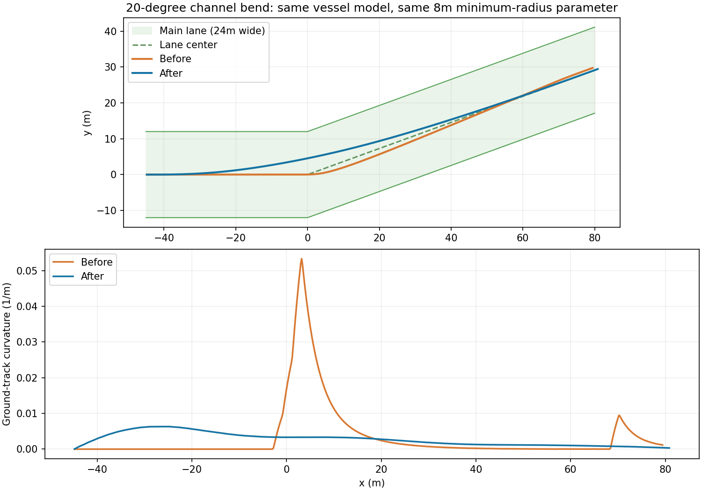

# 航道宽弧优化测试与调参

本次修改针对“长直线之后在航道折角突然集中转向”。最小转弯半径参数仍为 **8m**，最大艏摇率仍为 **0.45rad/s**，没有修改MPC、DWA或仿真船模。以下是可复现的算法测试，不是用户两张RViz截图的同坐标复现。

2026-10-04验证结果：Hybrid A*、航道管理器和控制器三个包构建成功；自动测试共57项全部通过（Hybrid 47项、跟踪3项、航道几何7项），`git diff --check`通过。本次没有运行RViz实时航行。

## 实现

1. 普通航道弯曲任务增加±1/16、±1/8低转向候选；搜索重复节点判定细分零附近艏摇率，使缓慢转向不会被直航节点过早合并。
2. 累计包含侧滑影响的实际航迹曲率平方，减少短区间内的曲率峰值。
3. Hybrid A*搜索成功后，尝试宽弧参考，并从同一初始`x/y/ψ/u/v/r`通过原欠驱动船模重新积分。输出的是船模轨迹，Bezier仅提供参考。
4. 所有候选逐步检查陆地、独立障碍、时间同步动态船和COLREG规则；到达原目标容差且总代价更低才采用。主航道内起终点的宽弧候选不得离开主航道；无合格候选时输出原搜索轨迹。

大角度掉头保持原转弯策略。曲率软代价不形成新硬性最小半径，所以窄弯、障碍和避让仍可采用较紧的合法转向。

## 普通缓弯对比

测试：宽24m的主航道，两段中心线夹角20°，巡航4m/s，路径约130m；起点/终点、船模、最小半径参数和碰撞参数相同。

| 指标 | 修改前 | 修改后 |
|---|---:|---:|
| 左弯峰值实际曲率 | 0.05335 m⁻¹ | 0.00632 m⁻¹ |
| 左弯峰值对应半径 `1/峰值曲率` | 18.7m | 158.3m |
| 有持续曲率的航段（曲率>0.001m⁻¹） | 43.2m | 107.2m |
| 总路径长度 | 130.02m | 130.01m |
| 对折线航道中心的最大偏差 | 1.71m | 4.53m |

宽弧需要提前转向，不能在折线中心的尖角处精确贴线，因此中心线最大偏差会增大；测试约束其仍在中部±5m内，距12m半宽的边沿仍有约7.5m。此偏差与为绕障临时靠边不是同一情况。右弯同样验证曲率降低、长航段持续转向和末端到达。



## 安全与可行性回归

- 左右两个方向：输出位置来自船模积分，保留初始状态；艏摇率不超过原上限，最小半径配置未改变，终点误差小于1m。
- 宽8m、45°的窄弯：仍可生成安全路径；实际曲率允许高于1/60m⁻¹，验证60m只是软尺度。
- 航道独立障碍加移动目标：逐点验证独立障碍未被航道清零，并按每个积分时刻检查目标船位置；测试最小同步净空4.50m，不低于设置的4m硬域。
- 同时执行已有对遇、交叉、追越、轨迹连续性和分源地图等回归测试。

## 调整方法

在`config/hybrid_a_star_params.yaml`修改后重启节点：

- `channel.broad_curve_radius: 60.0`：调到70~80通常更鼓励大弧；减小更贴合较紧河弯。这是曲率代价尺度，不是硬性半径。
- `channel.broad_curve_weight: 1.0`：增到1.5~2加强宽弧偏好；减小则更接近原轨迹，0关闭该曲率偏好和宽弧优化。
- `usv.gentle_turn_sampling: true`：增加低转向采样并开启宽弧候选；false恢复原采样、关闭宽弧候选。
- `channel.main_center_weight`仍控制中心梯度偏好；不要将它随意调到高于航道外代价，以免颠倒区域优先级。
- `channel.broad_curve_center_fraction: 0.6`：中部起终点的宽弧候选最高梯度为12/20，避免为了扩大半径而靠近边沿；减小更严格居中，增大允许更靠边。仅约束宽弧候选，不妨碍原搜索必要避障。

保持`min_turning_radius: 8.0`，避免为改善普通缓弯而失去掉头和窄弯能力。

## 复现

在工作空间根目录执行：

```bash
source /opt/ros/humble/setup.bash
colcon build --packages-select hybrid_a_star_planner
mkdir -p /tmp/usv_bend_report
USV_BEND_REPORT_DIR=/tmp/usv_bend_report build/hybrid_a_star_planner/test_v4 --gtest_filter=ChannelBroadBend.*
MPLCONFIGDIR=/tmp/usv_bend_plot_cache python3 src/hybrid_a_star_planner/test/plot_broad_bend.py --input-dir /tmp/usv_bend_report --output /tmp/usv_bend_report/comparison.png
colcon test --packages-select hybrid_a_star_planner channel_navigation_manager usv_mpc_control --return-code-on-test-failure
```

对比图由上述测试数据绘制，不代表已完成实船测试或本次运行了RViz实时航行。
