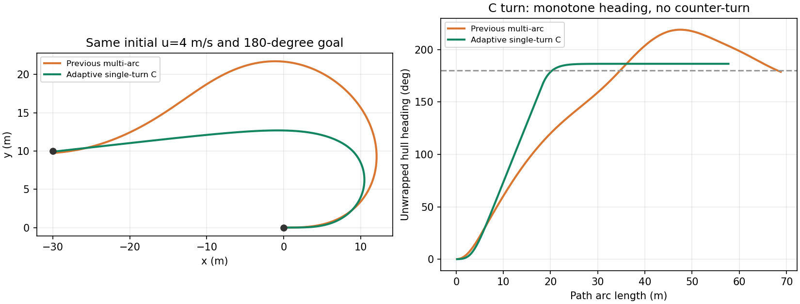

# 任务主航道锁存与自适应参考速度C弯规划

本次修改 `channel_navigation_manager` 与 `hybrid_a_star_planner`，不修改MPC、DWA、仿真船模。测试重点是规划轨迹，而非调整跟踪器让不合理的规划看起来可跟踪。

## 1. 主航道：新目标确定时锁存

任务方向是“新目标接收时的本船位置 → 最终目标位置”，不是船头、当前COG，也不是A*当前中间航点。最终目标订阅仍为 `/goal_pose`。

原来的锁存仅固定了一个角度，但还有两个问题：角度在odom计算、直接用于map海图；重建语义图时种子航段仍根据实时船位选择。现在同时固定任务起点、海图坐标系的任务方向和每个lane_id的完整角色。

```text
/goal_pose 新任务
  → 记录当时最后可用的/odom位置快照
  → 起点和目标都变换到/chart_lane_data的海图坐标系
  → 计算锁存的任务方位
  → 局部对向分道空间中线：任务方向的右侧为主航道种子
  → 沿相邻ORIENT连续传播主航道
  → 按lane_id保存分类 → /channel/lane_costmap 与Marker

/odom变化、转艏、侧滑、跨道、越过目标
  → 仅刷新诊断；不重新定义左右航道

地图元数据变化 / 海图数组重排
  → 使用锁存角色重新栅格化；不拿实时船位重新挑主航道
```

TF迟到时不暂按当前船头分类；保留新目标接收时的原始位置快照，待TF可用再变换。目标先于odom时，只用首次可用odom作为起点。重复的同一消息不重新锁存；重新点击的新时间戳消息，即使位置相同，也作为新任务。目标恰好与起点重合时位置不能定义方向，使用新目标消息中的艏向作为明确方向。

航道多边形也变换到代价地图坐标系，并考虑栅格原点旋转，不能仅变换目标而不变换海图。分道长短不一致时，先剔除质心的纵向错位，在本地航道横断面上比较左右，避免斜向目标误把长分道的质心偏移当成左右偏移。局部空间选右侧，ORIENT用于识别对向配对和沿弯曲河道传播，不再把船正在转弯的位置/艏向当作主航道依据。

相关函数：`goalCallback`捕获任务起点，`captureTaskOrigin`保存快照，`updatePolicyCourse`在海图坐标系锁存，`continuousMainLaneMask`选右侧种子和连续传播，`publishIfReady`复用角色/栅格化，`publishStatus`仅发布诊断。`/channel/status`增加 `policy_frame`、`task_origin`、`course_frame`，用于确认锁存方向与实时COG各自在哪个坐标系计算、用了哪次船位。

## 2. 规划：先找单向C弯，再考虑必要的多弧

原连接主要追逐几何Dubins引导。即使引导看起来不错，实际船模积分后转向、收舵和侧滑消退有滞后，可能在转向完成后用反向控制修正，形成S弯。仅提高反舵惩罚不能保证找到满足端点的C弯。

现在先使用 `connectMonotoneTurn` 的六状态船模转向位移匹配：

```text
大航向差 / 近距姿态调整
  → 按档位尝试规划参考速度 4、3、2、1.5、1.2 m/s
  → 必要时积分低速起步/残余侧滑过渡，高速则直接在转弯中减速
  → 单向转艏指令平缓增加，不交替左右控制
  → 根据艏摇惯性提前收舵，r和v自然衰减
  → 船模得到实际转向位移
  → 解非负入弯、出弯直段；180°情形二分匹配转向幅度
  → 从原始起点重放每个基元，逐子步验静态/动态/COLREG安全
  → 原始位置、艏向、长度、绕圈及实际航迹曲率符号验收
  → 按原航道/动态/侧滑软代价及效率选择安全C弯
  → 无合格C弯时，继续原Dubins船模连接和Hybrid A*搜索
```

C候选的转向脉冲只取一个符号，转向后是收舵，不用反舵补终点。提前收舵估计包含 `yaw_response_time × 当前r` 的剩余转角，避免船体已经对准却仍有转艏惯性。船模包含纵向推力、艏摇力矩、转弯掉速、侧滑阻尼和转弯诱导侧滑，输出不是直接绘制的圆弧。

为了匹配有限空间，在原0.22rad艏向容差内尝试少量转向余量；仍对原目标艏向验收，不修改用户目标，不扩大容差。候选同时检查地面航迹的累计反向曲率变化，不把“船头单向转、实际坐标仍明显S形”的路径标作C弯。

先前的整体Hybrid A*框架、启发场、基元安全检查、时间同步动态船检查、COLREG策略、正常缓弯宽弧优化和必要避障回退保留。安全优先，不能为了C外形穿越危险栅格或违反硬避碰约束。

### 参考速度不等于实船速度

`turning.reference_speeds` 是规划外推时的参考速度档位，不会把实测4m/s起点瞬间改成1.5m/s，也不会更改MPC的优化器或4m/s最高速度配置。高速起步直接在转弯中按船模减速，不强迫先直航等待速度完全下降，避免扩大掉头空间；仅过低起步速度/残余侧滑需要短过渡。不能用速度/角速度外推起点来补偿求解耗时。

所选参考速度仍通过原有 `/hybrid_a_star/speed_limit` 与Path配对机制发布，用于表明该路径采用的规划尺度。MPC代码本次未修改；这不是强制覆盖仿真船的实际速度，惯性响应仍由原控制/仿真模型决定。

参考转向尺度在正常8m、2m/s时5m、1.2m/s时3m之间插值。例如3m/s对应6.5m，1.5m/s对应3.75m；实际轨迹还受0.45rad/s艏摇率、推力和侧滑限制，并不是严格恒定半径。

## 3. 参数操作

文件：`config/hybrid_a_star_params.yaml`，已加入中文解释。

| 参数 | 默认值 | 调整效果 |
|---|---|---|
| `turning.prefer_c_curve` | true | false使用旧连接策略；true优先单向C弯，必要多弧回退仍保留 |
| `turning.reference_speeds` | `[4,3,2,1.5,1.2]` | 更多中间档更容易找到合适转向尺度，但增加候选计算；移除中间档可能选得过宽或过慢 |
| `cruise_speed` | 4m/s | 正常航行参考；本次不降低全程正常速度 |
| `large_turn.speed/min_radius` | 2m/s / 5m | 普通低速转向尺度的插值锚点 |
| `close_turn.speed/min_radius` | 1.2m/s / 3m | 最低速度和最紧转向尺度锚点；过低速度可能加大相对侧滑，并不能保证更稳定 |
| `large_turn.heading_threshold` | 1.57rad | 普通大角度启用阈值；减小扩大启用范围 |
| `close_turn.range/heading_threshold` | 15m / 0.7854rad | 近距45°以上姿态调整可启用；增大范围覆盖更多短程任务 |

参考档位自动补充正常、普通低速和最低速三个锚点，去重、排序，并限制在最低速与巡航速度之间。不支持通过写一个负速度进行倒航；当前船模与规划仍按前进运动约束运行。

主航道配置仍为 `../channel_navigation_manager/config/channel_navigation.yaml`。`reclassify_angle`仅用于无任务的备用分类；任务活动期间不决定是否翻转。`reverse_enter_angle/minimum_reverse_goal_distance`只影响诊断，不决定主航道。

启动前结束旧实例，再启动原一键运行：

```bash
source /home/l/work_ws/install/setup.bash
ros2 launch channel_navigation_manager river_navigation.launch.py
```

可查看 `/channel/status` 的 `task_origin/policy_course_deg_ros/policy_frame`，确认它们在同一任务中不因船舶转向或移动变化。Hybrid日志增加 `C_turn=yes/fallback`、`reference_speed`、`radius_scale`。yes表示新增单向连接，fallback表示原连接/搜索，不等于一定是S；原连接本身已经平滑且C形时也可保留。

## 4. 测试操作及适用边界

```bash
source /home/l/work_ws/install/setup.bash
ctest --test-dir /home/l/work_ws/build/channel_navigation_manager --output-on-failure
ctest --test-dir /home/l/work_ws/build/hybrid_a_star_planner --output-on-failure
python3 /home/l/work_ws/src/channel_navigation_manager/test/test_mission_lock_ros.py
python3 /home/l/work_ws/src/hybrid_a_star_planner/test/test_adaptive_c_turn_ros.py
```

前者使用隔离ROS域182，覆盖90°map/odom旋转、旋转栅格、迟到TF、转艏/跨道/越过目标/地图重建/航道数组重排不换道，新目标重新换边。后者使用隔离域183，运行真实Hybrid节点及完整YAML，测试多距离C弯、降参考速度、近距必要多弧和硬墙拒绝，不启动MPC或RViz。

`AdaptiveCTurn`在0和4m/s起步下测试后方15/30/60m、左右掉头及90°转向：原始目标位置/艏向、累计反向转艏、实际航迹反向曲率、最大艏摇率均验收。原20个极近距离姿态案例、宽弧平滑、COLREG和动态安全回归继续运行。具体最终数值及对照图见本说明的测试结果。

边界：同轴近距离180°目标、狭窄河岸/障碍或规则约束可能不存在单一C解。降低参考速度也不能消除所有物理不可达情况；必要时仍允许安全的多弧/S机动，而不是忽略目标姿态或强行穿岸。真的无安全路径仍返回blocked。测试地图为合成开阔/窄水域，没有宣称实际河图每个目标都通过，也没有用MPC闭环结果代替规划质量验收。

## 5. 最终测试结果（2026-10-10）

主航道8项、Hybrid/COLREG 58项，共66项单测通过；另有主航道锁存、真实Hybrid规划与后台路径刷新三个隔离节点回归通过。主航道还覆盖分道长度不一致、任务斜向时正确选右侧的几何案例。

10个C形状案例（5种目标×0/4m/s初始速度）和原20个近距姿态案例通过。后方C案例使用新增连接；原90°连接本身已是C形时允许保留原算法。末端均按原始目标位置、艏向门槛验收，最大艏摇率不超过0.451rad/s（0.001为测试浮点余量）。

实际Hybrid节点完整加载YAML，不运行MPC。起点(0,0)、初始艏向0、u=4m/s：

| 目标位置 / 目标艏向 | 所选参考速度 | 首条Path等待（含1Hz事件调度） | 轨迹形状 |
|---|---:|---:|---|
| (-15,8) / 180° | 1.5m/s | 约1.10s | 单向C |
| (-30,10) / 180° | 2m/s | 约1.00s | 单向C |
| (-60,20) / 180° | 3m/s | 约1.00s | 单向C |
| (-30,-10) / -180° | 2m/s | 约1.00s | 镜像单向C |
| (20,25) / 90° | 4m/s | 约0.99s | 原连接也是C，无反舵 |
| (2,0) / 180° | 1.2m/s | 约1.21s | 同轴极近姿态：保留必要多弧 |

不包含ROS调度的C案例搜索实测约0.01–0.05s，不能把上表等待都算作搜索时间。贯穿水域的硬墙仍发布blocked/空Path；原动态目标硬净空、安全规则和宽弧回归通过。末航点无解后台搜索时旧安全Path最长刷新间隔约1.002s，取消任务仍清空路径。

对照案例(-30,10)、180°、初始u=4m/s：旧路径累计反向转艏约0.702rad（40.2°），新路径约4.34×10⁻⁷rad（数值舍入量级），地面航迹没有明显反向曲率。新路径长度约57.7m；参考速度2m/s，转向中真实积分降速，不先增加一段等待完全降速的长直航。



绿色为更新后的规划轨迹，橙色为关闭新增C优先的同条件旧连接。右图可见旧航向先超过目标后反向回调，更新后单调转向并收舵。图为确定性规划回归，不是RViz截图或实船跟踪成绩。节点指标与日志在 `/tmp/usv_adaptive_c_*`、`/tmp/usv_mission_lock.log`；临时目录清理会移除这些日志，图和说明已保存在源码包内。

本轮不修改/运行MPC闭环脚本。旧 `test_large_turn_tracking_ros.py` 写了旧速度集合断言；今后拿它测新增1.5/3m/s档位时需同步测试断言，这不是MPC消息接口不支持新速度。
