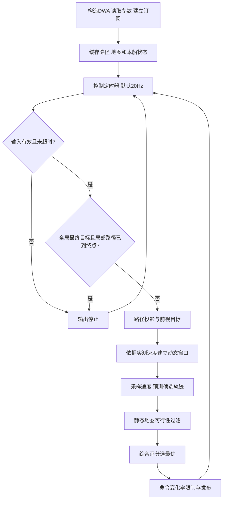
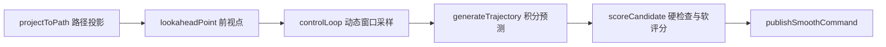
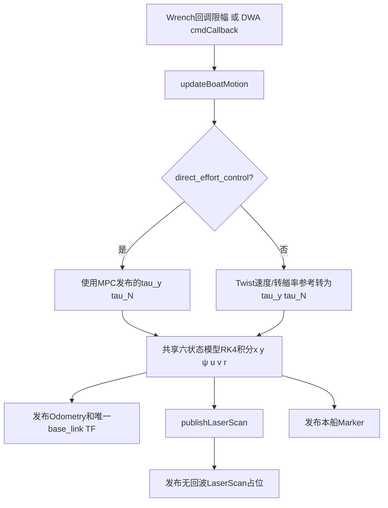

# DWA 与本船仿真说明

注意：源码文件夹叫 usv_mpc_control，ROS 包名是 **usv_mpc_control**。一键河道启动默认使用MPC跟踪欠驱动船模轨迹；传入`use_mpc:=false`可切回原DWA跟踪模式。动态避碰与COLREG仍由Hybrid A*统一决策。

## 1. 节点与接口

DwaPlanner 在 dwa_planner.cpp 中保留为兼容跟踪器；MpcController 在 mpc_controller.cpp 中直接优化欠驱动船体的纵向推力和偏航力矩；BoatSimulator 在 boat_simulator.cpp 中运行六状态欠驱动船体模型。MPC、DWA候选预测与仿真器共用 `include/usv_mpc_control/underactuated_model.hpp` 的状态方程和RK4积分。

| 方向 | 话题 | 功能联系 |
|---|---|---|
| DWA输入 | /hybrid_a_star_trajectory | Hybrid 连续提供避障航线 |
| DWA输入 | /local_costmap、/channel/lane_costmap | 静态安全与航道代价 |
| DWA输入 | /channel/obstacle_costmap（可选） | 独立障碍层，当前需外部生产者 |
| DWA输入 | /odom、Hybrid Path、local_costmap | 实际速度窗口和路径跟踪；动态船/COLREG由Hybrid统一处理 |
| DWA输出 | /cmd_vel / Twist | `linear.x`为期望前进速度u参考，`angular.z`为期望转艏率r参考；仿真器低层转换为τ_y、τ_N |
| DWA输出 | /optimal_trajectory | 选中的短时预测轨迹 |
| DWA输出 | /candidate_trajectories | 候选轨迹调试显示 |
| DWA输出 | /dwa_lookahead_target | 当前前视跟踪目标 |
| DWA输出 | /optimal_path | 收到的路径显示/转发，不是另一套全局规划 |
| MPC输入 | /hybrid_a_star_trajectory、/odom | 跟踪路径并读取完整船体速度状态`u/v/r` |
| MPC输入 | /local_costmap、/channel/lane_costmap、/chart_static_obstacles、/channel/obstacle_costmap | 与Hybrid A*一致进行河道分层安全判断；航道内忽略岸边膨胀，陆地/独立障碍不可忽略 |
| MPC输入 | /colregs/policies、/astar_channel_waypoints、/goal_pose_from_astar | 时间同步预测目标船、读取COLREG动作约束并区分中间航点与任务终点 |
| MPC输出 | /cmd_wrench | `force.x=τ_y`纵向合推力，`torque.z=τ_N`偏航力矩，供仿真器直接积分 |
| MPC输出 | /mpc/predicted_trajectory | 当前最优滚动预测青蓝线；无有效安全轨迹时删除旧显示 |
| 仿真输出 | /odom、odom→base_link TF | 提供本船位姿和实际速度 |
| 仿真输出 | /scan | 空的兼容占位数据，不用于航道地图或障碍物感知 |
| 仿真输出 | /sim_boat_marker | 欠驱动模型本船姿态显示；本节点不再发布任何内置障碍物 |

`/cmd_vel` 的 `linear.x` 是期望前进速度(m/s)，`angular.z` 是期望转艏率(rad/s)。这两个量是兼容现有DWA话题的参考值，不是欠驱动模型的直接控制输入。仿真器内部的实际控制量为纵向合推力`τ_y`和偏航力矩`τ_N`，不接受侧向推力/侧向速度命令。`/odom`中 `linear.x=u`、`linear.y=v`、`angular.z=r` 均以`base_link`船体坐标表达；位置运动使用`u cosψ-v sinψ`和`u sinψ+v cosψ`。

HIGH_SPEED模型使用：`u̇=-k_u u+k_T τ_y-k_turn r²`、`v̇=-k_v v+k_vr r-k_vN τ_N`、`ṙ=-k_r r-k_r3 r³+k_N τ_N`。`k_vr`按给出的模型为`-1.149012`。DWA预测时将每个候选速度/转艏率参考映射为有饱和限制的推力/力矩，再用同一六状态模型积分，因而能预测转弯侧滑和转弯掉速。
HIGH_SPEED模型使用：`u̇=-k_u u+k_T τ_y-k_turn r²`、`v̇=-k_v v+k_vr r-k_vN τ_N`、`ṙ=-k_r r-k_r3 r³+k_N τ_N`。`k_vr`按给出的模型为`-1.149012`。DWA会把速度/转艏率参考转为推力/力矩再积分；MPC直接搜索分段常值`τ_y/τ_N`序列，权衡加速、侧滑、艏摇惯性、舵向连续性与路径误差。

默认一键启动下，MPC直接发布`/cmd_wrench`，不让DWA和MPC同时驱动同一条船。MPC只执行优化序列的第一个推力/力矩控制量，下一周期用新里程计重新优化；无安全解或关键输入无效时制动。推力模式把纵向速度限制在`0..max_linear_speed`，不会因负制动力令船倒退。使用`use_mpc:=false`时MPC节点退出、DWA节点启动，仿真器改用`/cmd_vel`参考闭环。

## 2. 启动和控制流程

实测里程计速度用于下一周期窗口，不应把它误认为完全由上次发送命令决定。默认21×31速度候选，预测3秒、时间步长0.05秒；更多候选/更长预测耗时增加。

具体函数名以末尾源码函数索引为准。评分同时考虑路径距离、进度、方向、障碍、速度和控制变化；硬安全失败的候选不能靠高速度奖励获胜。大速度权重并不意味不减速；目标剩余距离、转角和急停仍优先限制速度。

## 3. 失效保护和边界

默认 `tracking_only=true`。DWA只跟踪Hybrid A*发布的Path，动态船距离、DCPA/TCPA、COLREG方向和会遇恢复均不在DWA中二次判定。DWA仅当全局活动目标和当前局部Path终点都与全局路线末点重合、且船到达终点容差时，才执行任务终点停车；普通航点不会触发终点刹车。无Path、输入失效或没有安全候选仍按失效保护停车。

航道语义允许忽略岸边膨胀，因此航道内真实障碍必须进入独立障碍层，不能仅混在岸线层里。DWA没有独立订阅河图原始陆地核心的完整防护链；不能把“在航道内清岸线代价”解释为对所有地图错误都安全。本轮只记录边界，没有改功能。

普通全局航点8米以内切换，途经点另有严格阈值。Hybrid在正常前向航点交接时保留旧有效轨迹，直到下一段搜索成功再替换；MPC/DWA不在普通航点减速停车，只有最终路径段到全局目标才启用终点速度包络。

## 4. 仿真启动与函数关系

BoatSimulator 构造时读取初始位置、航向、速度上限、障碍开关，创建状态更新与显示定时器。当前最高线速度4m/s，初始位置(-270,-270)。初始速度与实际有效配置以启动文件为准；没有控制输入时不应假定它必定静止。

实际设置的最高艏摇率为0.45rad/s，与Hybrid模型和MPC配置一致。MPC模式由Wrench直接施加τ_y/τ_N；DWA兼容模式仍订阅Twist参考。推力模式下船不会倒航。

仿真步长0.05秒。急停制动力矩施加后，实际速度仍遵循水动力学逐渐衰减，并非瞬间停止。仿真没有地图碰撞物理阻挡或实船执行器安全保护；直接推力模式的失联保护不能代替硬件急停。

请只运行一个本船仿真节点，否则会出现两艘base_link显示、里程计和TF竞争。不要在运行河道一键启动时再启动开阔水域一键场景。

## 源码函数逐项索引

以下按文件列出已注释函数。`[功能与联系]`代码注释可直接定位职责；同名重载/不同类函数分列。函数内局部计算与分支说明保留原有注释。流程图展示主要调用链，表格覆盖辅助函数、入口和测试。

### src/dwa_planner.cpp

生产或启动辅助源码。

| 函数 | 主要职责、调用联系与作用 |
|---|---|
| `DwaPlanner` | 读取控制/动态窗口/航道参数，订阅Hybrid路径并建立控制timer与RViz输出；默认不订阅目标船/策略，不负责生成稀疏全局航点。 |
| `pathCallback` | 接收Hybrid连续路径；少于两点立即清除可跟踪路径并发布STOP，正常路径更新接收时间。 |
| `costmapCallback` | 缓存物理地图及其网格元数据；航道节点用于对齐语义图，规划/控制节点用于碰撞和数据就绪检查。 |
| `odomCallback` | 缓存里程计和接收时间供controlLoop使用；实测速率用于动态窗口及失联保护。 |
| `controlLoop` | 先做跟踪输入有效性检查，再投影Hybrid路径与前视、建立动态窗口、生成评分候选并输出Twist；默认不执行动态船停车。 |
| `generateTrajectory` | 按候选常速度/角速度预测sim_time内姿态；scoreCandidate逐点检查静态/动态安全。 |
| `scoreCandidate` | 先用COLREG、同步目标净空和地图淘汰危险候选，再累计路径/进度/朝向/避障/速度/连续性评分，选择分数最大的候选。 |
| `projectToPath` | 把船或候选终点投影到最近路径段，得到横向距离与弧长进度；控制前视和评分共用。 |
| `lookaheadPoint` | 按路径累计弧长插值前视目标；controlLoop结合速度自适应前视距离使用。 |
| `pathHeadingAt` | 按指定弧长查询路径切向，用于候选终点朝向评分。 |
| `costAt` | 按地图原点姿态/分辨率查询代价，越界/缺图返回保守或未提供值；支撑多源融合和候选淘汰。 |
| `publishSmoothCommand` | 按变化限幅输出最佳Twist；使用实测速度建立约束，紧急STOP不经过这一平滑流程。 |
| `publishStop` | 直接输出零线速度和零角速度并重置命令记录；物理仿真仍按惯性制动，不代表瞬时停止。 |
| `publishOptimalPath` | 发布跟踪输入Path作为控制诊断；不是另一层全局搜索。 |
| `publishOptimalTrajectory` | 将最优局部预测候选绘为Marker，供RViz观察短时控制意图。 |
| `publishCandidates` | 绘制候选轨迹并区分有效/无效或评分；显示开销随速度采样数量增加。 |
| `publishLookaheadTarget` | 显示当前前视点，辅助定位跟踪方向与转弯响应。 |
| `pathPoint` | 按索引读取Path坐标；用于路径投影、前视插值及终点判断。 |
| `distance` | 计算两点欧氏距离，用于目标容差和路径段长度。 |
| `clamp` | 将标量限制到上下界，供速度/评分/插值计算共用。 |
| `normalizeAngle` | 归一化角度，消除跨±pi的跳变；方向比较、运动积分和COLREG约束共同使用。 |
| `interpolate` | 在上下界内按采样索引生成速度或角速度候选。 |
| `main` | 初始化ROS上下文、创建本文件节点并进入回调调度；退出时释放节点与通信资源，是launch启动可执行程序后的入口。 |

### src/boat_simulator.cpp

生产或启动辅助源码。

| 函数 | 主要职责、调用联系与作用 |
|---|---|
| `BoatSimulator` | 建立六状态欠驱动模型、执行器限制和控制订阅，启动20Hz运动和数据发布；只能运行一个base_link发布者。 |
| `cmdCallback` | 缓存DWA期望前进速度/转艏率参考并限幅；不设置侧向速度。 |
| `effortCallback` | 缓存MPC发布的Wrench纵向推力与偏航力矩并限幅；仅在直接力矩控制模式参与推进。 |
| `update` | 本船仿真定时入口，依次调用updateBoatMotion、publishOdomAndTf、publishLaserScan与publishBoatMarker，统一推进状态并发布观测。 |
| `updateBoatMotion` | MPC模式直接使用最近的τ_y/τ_N；DWA模式由`trackSetpoint`换算Twist参考。两种输入均经共享RK4推进x/y/ψ/u/v/r，MPC模式下速度限于非负。 |
| `publishOdomAndTf` | 发布本船/odom及odom→base_link，反馈给航道分类、两级规划器并供RViz定位。 |
| `publishLaserScan` | 保持`/scan`话题兼容，发布无回波占位数据；不再模拟任何障碍物或扫描海图。 |
| `publishBoatMarker` | 在本船姿态处显示模型；与TF显示重复开启时可能看似有两艘船。 |
| `main` | 初始化ROS上下文、创建本文件节点并进入回调调度；退出时释放节点与通信资源，是launch启动可执行程序后的入口。 |

### 欠驱动模型参数及调节

`config/sim_params.yaml`与`config/dwa_params.yaml`中的`model.*`系数必须保持一致。它们分别表示纵向阻尼/推力增益/转弯掉速、侧滑阻尼/转艏诱导侧滑/偏航耦合、以及线性/三次转艏阻尼和力矩增益。请以实船辨识或仿真标定值替换默认HIGH_SPEED系数。

`surge_response_time`和`yaw_response_time`是规划器参考输入模型中的时间常数：减小会让指令响应更快、耗用更大推力/力矩；增大会让预测船更迟缓。`max_tau_y`和`max_tau_n`限制输入幅值，调低可能使跟踪能力不足，调高则动作更强。仿真器与MPC/DWA的水动力系数、速度和艏摇率限幅、执行器限幅必须一致。τ单位依模型辨识标定约定；当前系数说明未提供物理单位，不能直接当作牛顿或牛顿·米。

### src/mpc_controller.cpp

生产节点，10Hz滚动优化器；`use_mpc:=false`时不启动。

| 函数 | 主要职责、调用联系与作用 |
|---|---|
| `MpcController` | 读取优化/模型参数，订阅路径、里程计、地图与会遇策略，创建`/cmd_wrench`和预测线发布器。 |
| `onPath` / `buildSegments` | 缓存Hybrid Path并转为弧长分段；任务路径发生变化时重置暖启动。 |
| `updateFinalGoal` | 同时比较活动航点、全局路线终点和当前局部Path终点；旧段交接时不提前触发最终制动。 |
| `project` | 将实船或预测状态投影到参考路线，获得横向误差、切向和路径进度。 |
| `worldToCell` / `cellValue` / `mapSafe` | 按每层OccupancyGrid原点姿态查询船体九点包络；复用Hybrid A*河道、陆地和独立障碍分源判定。 |
| `dynamicSafe` | 按Encounter速度同步外推目标船，检查动态硬净空、COLREG可达转向与软距离代价。 |
| `seedControls` | 从路径切向与终点速度包络生成首个推力序列，并滚动上一次解作为warm start。 |
| `rollout` | 用六状态RK4推进候选力矩序列，以横向误差生成回轨修正航向，再累计航向/进度/速度/侧滑/力矩平滑与避碰代价；任一硬安全失败即判无穷代价。 |
| `controlStep` | 输入检查→当前状态路径投影→候选序列坐标下降→只执行首个Wrench→发布预测轨迹。 |
| `publishBrake` / `clearPrediction` | 输入过期或无安全序列时发布制动力矩并删除旧预测Marker。 |
| `publishPrediction` | 将当前滚动预测发布到`/mpc/predicted_trajectory`，RViz显示为青蓝线。 |
| `main` | 创建MPC节点并进入ROS回调循环。 |

### launch/river_navigation.launch.py 的控制器选择

`use_mpc`默认`true`：启动`mpc_controller`，让仿真器直接消费`/cmd_wrench`，不启动DWA。命令`ros2 launch channel_navigation_manager river_navigation.launch.py use_mpc:=false`可切回DWA跟踪，并让仿真器使用`/cmd_vel`。不要同时手动启动两种控制器。

### launch/dwa_sim.launch.py

生产或启动辅助源码。

| 函数 | 主要职责、调用联系与作用 |
|---|---|
| `generate_launch_description` | 组装节点、参数与条件启动动作；launch只负责接线，不直接执行规划或控制。 |
