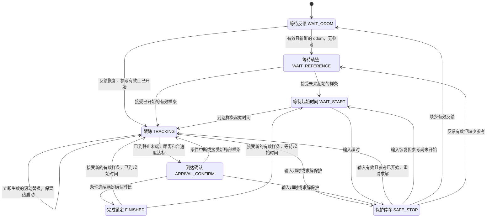

# NMPC 局部轨迹跟踪状态机

`TrackingStateMachine` 是唯一的生命周期状态源。它只决定是否允许求解、何时完成及保护原因；ROS 节点负责输入校验、样条求值、求解与输出。数值模型、六状态参考、优化代价、控制限幅及 `UsvBspline.msg` 保持原有语义，不增加配置参数。

## 状态转移图



为保证图可读，全局规则另外列出：

- 除 `FINISHED` 外，任何状态缺少有效反馈都转入 `WAIT_ODOM`；反馈有效但过期则转入 `SAFE_STOP:ODOM_TIMEOUT`。
- 反馈新鲜、没有参考时进入 `WAIT_REFERENCE`；参考过期时进入 `SAFE_STOP:REFERENCE_TIMEOUT`。未来起始的参考同样要保持新鲜。
- `/planning/mission_reset` 清空参考、到达计时及热启动，反馈新鲜时进入 `WAIT_REFERENCE`；`/nmpc/reset` 还清空反馈并重建求解器，进入 `WAIT_ODOM`。二者立即发布零指令，复位前的旧 `start_time` 被接收屏障拒绝。
- `FINISHED` 保持锁定。重复重发、拒收轨迹、状态失效及超时不会解除锁定；只有新的有效样条或显式复位解除。
- ROS 时间回退时立即发布零指令并清除旧时间域的反馈、参考及热启动，先报告 `SAFE_STOP:CLOCK_REWIND`，再等待新输入；已完成任务继续锁定。ROS 时间暂停时不重复求解、不推进到达计时，墙钟反馈超时仍生效。

## 状态与动作

| 编号 | 状态 | 当周期动作 |
| --- | --- | --- |
| 0 | WAIT_ODOM | 发布零指令，等待有效反馈 |
| 1 | WAIT_REFERENCE | 发布零指令，等待可接受样条 |
| 2 | WAIT_START | 发布零指令，等待绝对起始时间 |
| 3 | TRACKING | 按样条绝对时间构造六状态参考，求解并发布限幅指令 |
| 4 | ARRIVAL_CONFIRM | 继续正常 NMPC，累计连续到达时间 |
| 5 | SAFE_STOP | 当周期发布零指令、清空显示的预测路径；后续有效周期自动重试 |
| 6 | FINISHED | 持续零指令，完成话题保持 true |

`SAFE_STOP` 表示发布零控制指令，不保证有惯性的船体立即静止。求解失败与参考求值失败不会要求人工复位；下一有效控制周期可重新求解，失败则再次保护。只有状态或原因变化时记录转移日志。

## 滚动参考与到达确认

轨迹通过原有检查后才接收：消息合法、有新鲜反馈、当前时刻的样条点距船位不超过 `max_reference_start_distance_m`（默认 2 m）。新片段起始时间已到时立即替换；若控制器正在跟踪且新片段的绝对起始时间在未来，则保留当前有效样条并继续求解，将最早的未来片段排队，到其绝对起始时间再切换。后续更新不能不断推迟这个切换时刻。待切片生效时增加轨迹版本；求解器实例、热启动和真实控制周期始终保留。没有当前有效样条时，控制器仍进入 `WAIT_START` 并等待首段起始时间。完全相同的消息只刷新参考接收时间；拒收消息保留先前的有效参考，也不刷新其有效期。

到达确认沿用三个配置：`finish_distance_m`、`finish_speed_mps`、`finish_stable_duration_s`，默认分别为 2 m、0.2 m/s、1 s。前提仍为样条时间已到末端且末端导数近零；在此基础上，实船到终点距离和 `hypot(u,v)` 连续达标才完成。不使用航向误差或角速度作为到达条件。

非零末速的局部样条保持 `TRACKING`；到达确认中的新有效段重新计时，完全相同的末段重发则保留计时。任一到达条件中断、输入失效或求解保护都清除连续计时。

## 观测与代码入口

```bash
ros2 topic echo /nmpc_tracking_state --qos-durability transient_local
ros2 topic echo /USV_tracking_finished --qos-durability transient_local
```

状态话题为 `std_msgs/msg/String`，例如 `ARRIVAL_CONFIRM` 或 `SAFE_STOP:REFERENCE_TIMEOUT`。保留原有诊断数组 d0～d66，追加 d67 状态编号与 d68 保护原因。原因编号为：0 NONE、1 ODOM_TIMEOUT、2 REFERENCE_TIMEOUT、3 CLOCK_REWIND、4 HORIZON_INVALID、5 SOLVER_FAILED、6 COMMAND_INVALID。

- `include/usv_nmpc_controller/tracking_state_machine.hpp`、`src/tracking_state_machine.cpp`：状态、事件条件与计时。
- `src/usv_nmpc_node.cpp`：`timerCallback` 处理输入门控和状态分发，`executeTrackingCycle` 负责单次跟踪，`publishTrackingState` 统一发布状态和完成标记。
- `src/usv_nmpc_diagnostics.cpp`：终端读取同一状态机，显示实际发布的指令。
- `test/tracking_state_machine_test.cpp`：确定性转移、保护、连续计时与锁定测试。
- `test/arrival_completion_test.cpp`：通过真实 ROS 回调验证状态、零指令、滚动替换、超时恢复、到达和复位。
